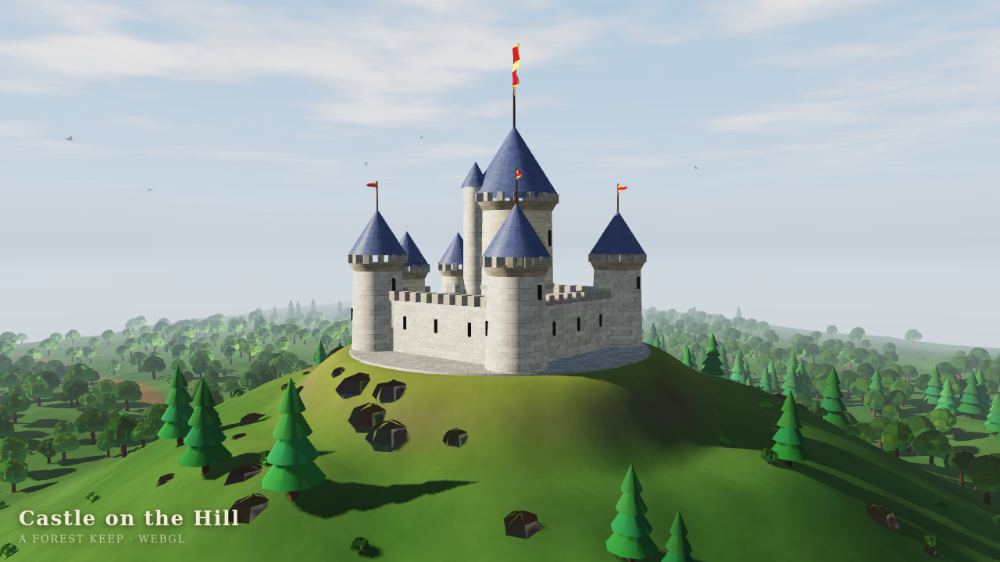

# Castle on the Hill

A self-contained 3D animation that runs entirely in the browser: a medieval castle
crowning a hill above a large forest, with the camera orbiting the keep and the
banner on the tower streaming in the wind.

## Running it

Open `index.html` in any browser with WebGL 2 (Chrome, Firefox, Safari, Edge).
It works straight from the filesystem (`file://`) — there is no build step, no
server and no external asset or library: everything (geometry, textures, sky,
lighting) is generated procedurally in a single HTML file.

## What is in the scene

- **Castle** — curtain walls with crenellations, four corner towers with conical
  roofs, a gatehouse with an oak gate, a great hall and outbuildings in the
  courtyard, and a keep with a machicolated crown carrying the flagpole.
- **Flag** — a cloth grid displaced by a travelling wave in the vertex shader,
  lit two-sided with light bleeding through the fabric; four pennants on the
  corner towers wave with it.
- **Hill and forest** — a procedural heightfield (value-noise fBm) with a flat
  plateau for the castle, a track winding up to the gate, and ~2300 instanced
  conifers, broadleaf trees and bushes that sway in the same wind.
- **Light and air** — a directional sun with a 2048² shadow map (3×3 PCF),
  hemispheric ambient, procedural stone/slate/grass detail, aerial perspective,
  drifting clouds, distant mountains and a flock of birds.
- **Camera** — a seamless orbit that loops every ~74 seconds, rising and falling
  so the castle is seen from every side. No controls, nothing to press.

Appending `#t=42` to the URL freezes the animation at that second, which is handy
for stills.
